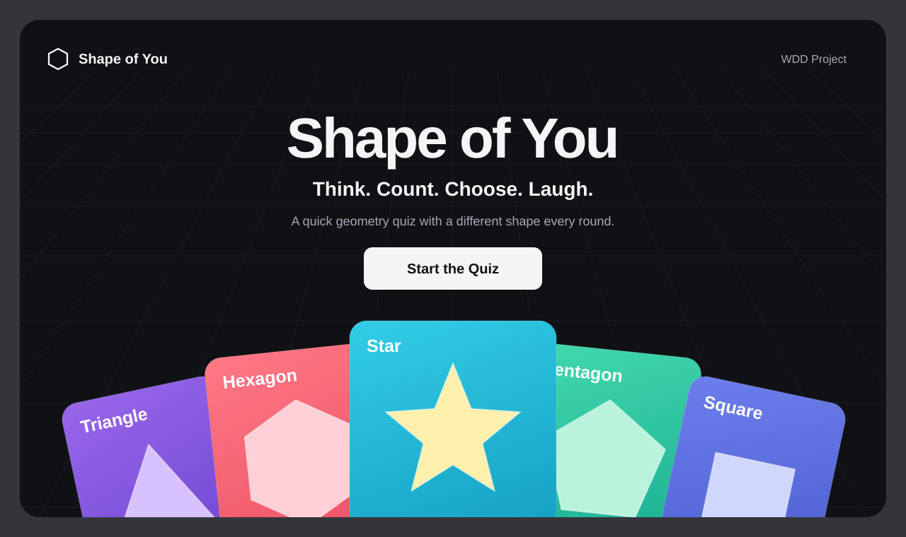

# Shape of You

**Think. Count. Choose. Laugh.**

A browser-based geometry quiz built for the Web Design & Development course, 4th Semester, CST — Section A.

[**Open the live website**](https://knownassa.github.io/ShapeOfYou/) · [Development guidelines](AGENTS.md)

  

## Landing page

[](https://knownassa.github.io/ShapeOfYou/)

*Design concept — the planned landing-page composition, not a screenshot of the current build.*

The design uses a dark neutral background, clear typography and five overlapping geometry cards. The colorful shapes are the main visual focus.

## The project

Shape of You turns geometry practice into a short, playful challenge. The intended experience is to observe a generated shape, choose an answer, receive feedback and complete a ten-question round.

| Implemented so far | Planned functionality |
| --- | --- |
| Semantic HTML foundation | Procedural polygon and star generation |
| Landing content and Start button | SVG-based questions and four unique choices |
| Initial CSS theme | Answer validation, scoring and GIF reactions |
| Development and design contract | Responsive quiz, results and restart |

**Status:** In development. The live page is a work in progress; the quiz engine and final landing layout are not yet implemented on the inspected `Main` branch.

## Team

| Member | Roll | Responsibility |
| --- | --- | --- |
| Sayef Ahmed | 243231 | Team leader, JavaScript, integration and optimization |
| Jubayer Islam Sajid | 243204 | HTML and structural CSS |
| Wasiul Islam Sohan | 243209 | Visual CSS, responsive styling and animations |

## Run locally

```bash
git clone https://github.com/Knownassa/ShapeOfYou.git
cd ShapeOfYou
```

Open `index.html` in a modern browser. No framework, package installation or build process is required. External fonts and future GIF reactions may require internet access.

## Development

The intended source structure is:

```text
ShapeOfYou/
├── index.html
├── css/
│   ├── layout.css
│   └── style.css
├── js/
│   └── script.js
├── docs/
│   └── landing-layout.svg
├── AGENTS.md
└── README.md
```

Some source files are created in later development tasks.

Permanent branches: `Main` (Sayef), `Sajid` (HTML/layout), and `Sohan` (visual CSS). Each member completes one scoped task and commits separately. Member changes are reviewed and merged into `Main`.

Read [AGENTS.md](AGENTS.md) before contributing.

---

Web Design & Development · Computer Science & Technology · 4th Semester, Section A
